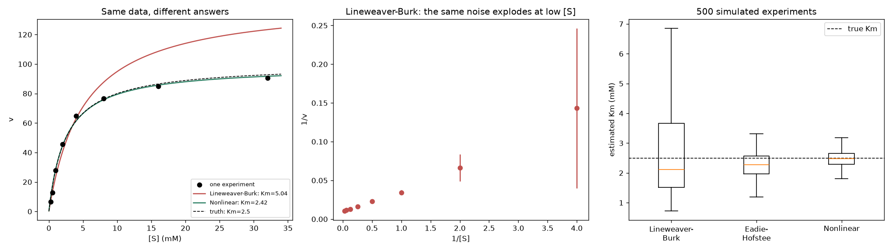

# Michaelis-Menten Kinetics, Fitted Properly

> The Lineweaver-Burk plot was a brilliant workaround in 1934, when you fitted lines with a ruler. You have a computer now.

## Demo Output



Produced from simulated enzyme assays by `demo.py`: one experiment fitted two ways, how a double-reciprocal plot inflates noise, and Km estimates from 500 repeat experiments.

## Why This Exists

Biochemistry courses still teach linearised plots as the way to get Km and Vmax. Taking reciprocals turns small errors at low substrate concentrations into enormous ones, and an ordinary straight-line fit then lets those points dominate. This repo fits the same simulated data three ways, repeats it 500 times, and reports bias and spread for each method.

## Methods

| Method | Transform | Problem |
|--------|-----------|---------|
| Lineweaver-Burk | 1/v against 1/[S] | Low-[S] points get huge error and leverage |
| Eadie-Hofstee | v against v/[S] | v sits on both axes, so errors are correlated |
| Nonlinear least squares | none | Needs starting values (a linear fit provides them) |

The demo assumes constant measurement noise, as with most absorbance read-outs. If your errors grow with the rate (constant CV), weight the nonlinear fit by 1/v² or fit on a log scale. Unweighted least squares then lets the high-[S] points dominate.

## Usage

```python
from kinetics import fit_nonlinear
vmax, km, se_vmax, se_km = fit_nonlinear(substrate, rate)
```

## When NOT to Use This

- **Substrate inhibition or cooperativity** (Hill kinetics). Michaelis-Menten is the wrong model, however well you fit it.
- **Tight-binding inhibitors** or enzyme concentrations close to Km break the steady-state assumptions.
- **No points near or above Km.** No fitting method can estimate a Km you never sampled.

## The Uncomfortable Truth

Linear plots are good for *showing* inhibition patterns, and bad for *estimating* parameters. If a published Km came from a Lineweaver-Burk regression, give it generous error bars.

## Further Reading

- Michaelis L. & Menten M. L. "Die Kinetik der Invertinwirkung." Biochemische Zeitschrift (1913).
- Lineweaver H. & Burk D. "The determination of enzyme dissociation constants." Journal of the American Chemical Society (1934).
- Cornish-Bowden A. "Fundamentals of Enzyme Kinetics." Wiley-Blackwell.
